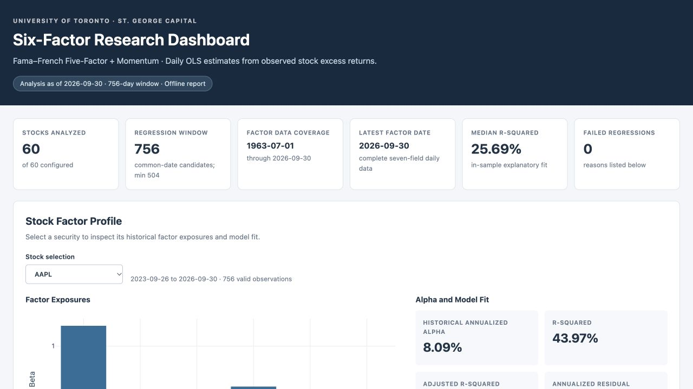

# Project 2 — Risk & Backtesting Tool

**Current stage: Phases 1 and 2 complete; Universe V2 complete; Phase 3 not started.**

**Last reviewed: November 8, 2026**

This directory contains the **code-only research deliverables** for Project 2 of the St. George Capital (SGC) Optimization Team. Its purpose is to build a reusable foundation for portfolio risk attribution, stress testing, and out-of-sample walk-forward backtesting. **A completed portfolio backtester is not yet implemented.**



## Progress at a glance

| Workstream | Status | Deliverables |
| --- | --- | --- |
| Phase 1 — Market data pipeline | Complete | US equity daily prices and adjusted returns; download/update, validation, caching, and reproducibility manifests |
| Phase 2 — Six-factor analytics | Complete | Fama–French five factors + Momentum, 60-stock OLS regression, CSV outputs and self-contained offline HTML dashboard |
| Universe V2 — Historic crisis coverage | Complete with limitations | 60 hand-curated securities, 11 sectors, requested data from 1995; issuer-history and crisis-coverage audits |
| Phase 3 — Covariance & portfolio risk | Planned next | Factor covariance `B Σ_F Bᵀ + D`, sample covariance, Ledoit–Wolf, risk contributions |
| Phase 4 — Strategy backtesting | Not started | Walk-forward engine, dated strategy weights, rebalancing and transaction costs |
| Phase 5+ — Stress testing / integration | Not started | Strategy comparison, factor risk attribution, historical shocks and API for SGC website |

**Last validated run (standalone workspace):** 60/60 stocks with saved price data through November 6, 2026; 60/60 current six-factor regressions through September 30, 2026 (latest common factor endpoint); 99 unit tests passed, 1 optional live-integration test skipped. The available stock histories begin as early as January 3, 1995. These are research results, not forward return forecasts or a production backtest.

## How this relates to Project 1

- **Project 1 (Portfolio Optimization)** takes analyst forecasts and optional Black–Litterman views, then returns dated target weights under portfolio constraints.
- **Project 2 (Risk & Backtesting)** estimates portfolio risks, independently simulates trades and costs using only data available at each historical decision date, and evaluates the resulting strategies against baselines.
- **Expected interface:** `as_of_date`, `available_market_data`, `analyst_views`, `current_weights`, `constraints` → `target_weights` plus optimizer metadata. Project 1 owns the optimization logic; Project 2 owns backtest and diagnostics.

The historical as-of interface, point-in-time safeguards and walk-forward engine are **planned**, not yet implemented.

## Repository organization

```text
project2/
├── config/              # Market-data, factor and universe research configuration
├── src/portfolio_backtester/
│   ├── data/             # Download/update, normalization and quality checks
│   └── factors/          # Six-factor regression and local HTML dashboard
├── scripts/             # Reproducible CLI entry points
├── tests/               # Offline unit and regression tests
├── docs/                # Execution notes, model methodology and audits
├── pyproject.toml       # Standalone project dependencies
└── requirements-lock.txt
```

## Run locally

The team's top-level `requirements.txt` is separate; install **Project 2** from this directory to get its full dependencies:

```bash
cd project2
python3 -m venv .venv
source .venv/bin/activate
python -m pip install -e '.[dev]'
python -m pytest
```

The repository includes **vetted derived research outputs** in [`outputs/`](outputs/) and the fully self-contained [factor dashboard HTML](reports/factor_dashboard.html) in [`reports/`](reports/). Download the HTML file and open it locally in a browser; GitHub's file viewer will display source rather than execute the dashboard. Raw price/factor source datasets remain excluded from the public repository.

To regenerate the dashboard and model outputs from fresh source data, start with:

```bash
python scripts/download_prices.py
python scripts/download_factors.py
python scripts/run_phase2.py --skip-factor-download
python scripts/audit_universe_history.py
python scripts/validate_data.py
```

Then open `reports/factor_dashboard.html` locally. The download may be extensive; Yahoo Finance and Kenneth French source availability, their use/redistribution terms, and market-data freshness should be checked separately. The committed Dashboard is a **dated research snapshot**; rerunning the pipeline can generate updated outputs. The screenshot above previews the committed Dashboard.

For detailed method and evidence, read [lead review summary](docs/lead_review_summary.md), [six-factor methodology](docs/phase2_factor_model.md), [Universe V2 audit](docs/universe_v2_history_audit.md), and [Universe V2 execution report](docs/universe_v2_execution_report.md).

## Research limitations

- The 60-company universe is selected from **survivors**, not reconstructed from point-in-time historical constituents. Survivorship and hindsight bias remain.
- Some ticker and corporate-action histories require identity/split verification (see the audit flags). Available returns alone do not establish past investability.
- The historical factor download is a current vintage, not necessarily what investors knew on each historical publication date.
- Six-factor OLS regressions explain exposures in a sample. They are **not** forward alpha estimates.
- Cross-crisis price coverage does not demonstrate that any proposed trading strategy would have outperformed during those crises.

**Team workflow:** use a `p2/...` branch and a pull request; do not commit market datasets, research PDFs, user backups, caches or virtual environments to this public repository.
